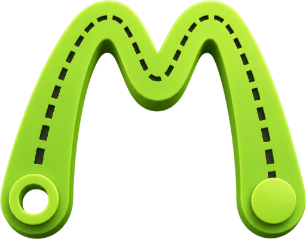

<picture>
  <source media="(prefers-color-scheme: dark)" srcset="./assets/banner-dark.svg">
  <source media="(prefers-color-scheme: light)" srcset="./assets/banner-light.svg">
  
</picture>

  
  
  

  German software company building secure, scalable SaaS for regulated industries. 
  Product, cloud, design and engineering, all in-house, security first.

 

## Products

<table>
  <tr>
    <td width="50%" valign="top">
      
      <h3>Passfest</h3>
      
<b>Digital Product Passport platform</b>

      
Helps manufacturers meet the EU Digital Product Passport rules, including <b>ESPR</b> and the <b>EU Battery Regulation</b>. Product, material and supply-chain data in one place, published as secure, QR-addressable passports for the European Mittelstand.

      

        <a href="https://passfest.com">passfest.com</a> ·
        <a href="https://passfest.de">passfest.de</a>
      

    </td>
    <td width="50%" valign="top">
      
      <h3>MitaBase</h3>
      
<b>Medical transport operations platform</b>

      
Dispatch software for medical transport providers in Germany. Scheduling, dispatching, fleet coordination and digital workflows in one platform, with a native driver app.

      

        <a href="https://mitabase.com">mitabase.com</a> ·
        <a href="https://mitabase.de">mitabase.de</a>
      

    </td>
  </tr>
</table>

## How we build

  
  
  
  
  
  
  

| | |
|---|---|
| 🇩🇪 **German infrastructure** | Built for EU customers on German infrastructure |
| 🔒 **Privacy by design** | GDPR-first architecture from the first line of code |
| 🛡️ **Secure by default** | Two-factor auth and least-privilege access across the team |
| 🔄 **Automated delivery** | Containerized services, CI/CD, infrastructure as code |

## Mission

**Make regulatory software simple.** We turn complex European regulation into products people actually enjoy using.

 

  <a href="https://etmita.com"><b>etmita.com</b></a> 
  Etmita UG (haftungsbeschränkt)

